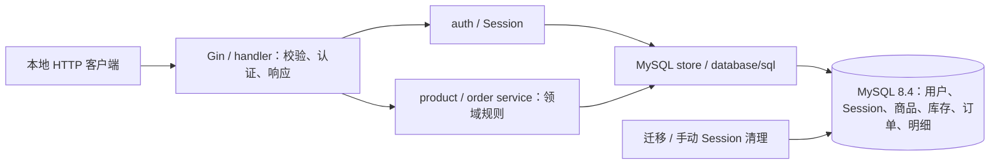
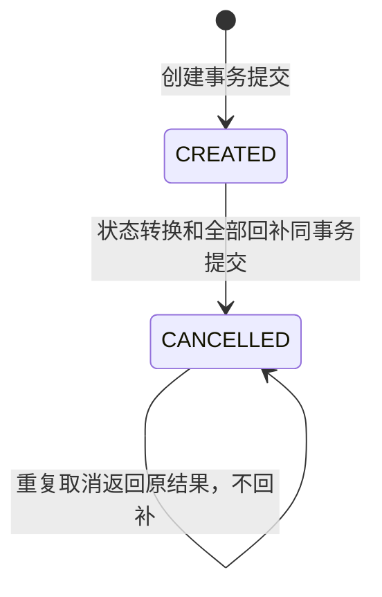

# Order API — Go / Gin / MySQL 事务与并发项目

Go + Gin + MySQL 8.4 的订单与库存单体后端，关注数据库事务中的库存竞争、用户级幂等、并发取消和失败后的结果核验，而不是堆叠中间件。

这是用于学习与求职展示的本地工程项目：多个用户并发购买有限库存时，如何避免超卖、重复下单和重复取消回补。仅使用合成数据，不连接支付，未生产上线或提供公网服务。

本项目是经过文件级审查的独立源码展示版本，不携带原项目 Git 历史。新仓库为 [liyzh7/go-order-inventory-api](https://github.com/liyzh7/go-order-inventory-api)。状态记录：2026-10-24（P7b），仓库仍为 **Private，尚未切换 Public**。P6 根提交 `9e40815202220dd919e3db485e38c1e53c0bdb99` 的[首次云端 CI](https://github.com/liyzh7/go-order-inventory-api/actions/runs/39962402403)两个 Job 均 SUCCESS。

该 Run 只验证上述根提交；本轮 Markdown 文档变更仅作本地提交、尚未 Push，**新文档提交尚无自身 SHA 对应的 GitHub CI 结果**。原私有项目的历史验收只作来源背景，不代替新仓库证据。项目采用 [MIT](LICENSE)，第三方许可见 [依赖声明](third_party/README.md)。

事务把订单头、明细快照与库存扣减作为一个整体提交；`available_qty >= quantity` 的条件更新和影响行数检查避免并发读后写造成超卖。用户与幂等键唯一约束配合请求摘要，让客户端在超时后以原键重试：同请求返回原订单，不同参数拒绝。并发测试同时核验订单数量、明细、金额与逐商品库存守恒。

## 工程能力与边界

- 商品游标分页和详情查询，一次 JOIN 返回库存，避免 N+1。
- 注册、登录、退出、当前身份；Argon2id 密码哈希、256-bit 随机 Session、仅存 Token SHA-256、24 小时绝对有效期。
- 认证身份贯穿 service 和 SQL；只能操作自己的订单，越权与不存在统一返回 404。
- 多商品创建：整数分金额、数据库价格和名称/SKU 快照、条件库存扣减及 RowsAffected 检查；订单头/明细/库存同事务。
- 用户级字节敏感幂等键唯一约束、规范化 SHA-256 请求摘要；相同请求重放，不同参数返回 409。
- 取消：订单行锁 + CREATED → CANCELLED 条件更新，按商品 ID 升序回补；重复/并发取消只回补一次。
- 仅对明确 MySQL 错误码有限重试；Commit 未知时独立读取原用户/原键，不盲目重做副作用。
- 有界 Session 清理 CLI、安全 JSON 日志、请求 ID、连接池、HTTP/SQL 超时及优雅退出。
- 真实 MySQL 并发/故障测试、Linux 单元/数据库 Race、有界 k6、稳态和恢复实验。

不包含支付、退款、分布式事务、集群容灾或生产容量保证。MySQL 是库存唯一真相来源，无 Redis、Kafka、微服务或分布式锁。

## 架构与核心流程



创建事务：按确定顺序读取商品（FOR SHARE）→ 写订单头和快照明细 → 商品 ID 升序条件扣库存 → 检查每次更新影响 1 行 → Commit。任意失败整体回滚。先写快照再拿库存排他锁，缩短热点库存锁持有时间，没有删除约束或放宽一致性。

```sql
UPDATE inventories SET available_qty = available_qty - ?
WHERE product_id = ? AND available_qty >= ?;
```



详情用一条 JOIN 获取订单头与历史快照；取消先锁定当前用户的订单。历史 user_id IS NULL 订单保留，不可被普通用户认领。详见 [数据库设计](docs/database-design.md)、[订单事务](docs/order-transaction.md)。

## 本地运行

需要 go.mod 指定的 **Go 1.27.2**、Docker Desktop/Compose、**PowerShell 7**。无需本机 MySQL Server/CLI。应用运行在宿主 Go 进程，MySQL 使用持久化容器；没有生产应用镜像。

在项目根目录执行：

```powershell
Copy-Item .env.example .env
# 编辑 .env，替换两个密码占位值。禁止提交真实值。
. ./scripts/load-env.ps1
docker compose --env-file .env -f deploy/compose.yaml up -d
docker compose --env-file .env -f deploy/compose.yaml ps
go run ./cmd/migrate up
go run ./cmd/migrate status
./scripts/seed-dev.ps1 # 可选，仅本地模拟商品，不自动运行
go run ./cmd/server
```

另开终端请求 http://127.0.0.1:28080/health。端口以 .env 为准（候选示例 HTTP 28080、MySQL 13307）；数据库仅发布回环地址，Volume 为 order-api-showcase-mysql-data。停止使用：

```powershell
docker compose --env-file .env -f deploy/compose.yaml stop
```

不要通过删除 Volume 修复问题。Goose 迁移 1～6 不随应用启动自动执行；Down 需要显式危险确认、精确库名且只允许一次性测试库。迁移 6 的旧全局唯一键回滚可能因合法跨用户同键而失败，应新增向前迁移，不能删订单凑回滚。

## API

| 接口 | 身份 | 行为 |
| --- | --- | --- |
| GET /health | 无 | 存活检查，不代表数据库就绪 |
| GET /products?limit=20&after_id=0 | 无 | ID 游标，单页最多 100 |
| GET /products/:id | 无 | 启用商品详情 |
| POST /auth/register、/auth/login | 无 | 严格 JSON、用户名归一化、本地有界限流 |
| GET /auth/me、POST /auth/logout | Bearer | 当前身份 / 撤销当前 Session |
| POST /orders | Bearer + Idempotency-Key | 首次 201；同请求重放 200 |
| GET /orders/:id | Bearer | 自己的订单及快照 |
| POST /orders/:id/cancel | Bearer | 首次/重复均 200，只回补一次 |

PowerShell 示例不包含固定账户或密码：

```powershell
$username = Read-Host 'Username (3-32 ASCII letters/digits/underscore)'
$password = Read-Host 'Password (12-128 UTF-8 bytes)' -AsSecureString
$credential = [pscredential]::new($username, $password)
$body = @{username=$username;password=$credential.GetNetworkCredential().Password} | ConvertTo-Json
Invoke-RestMethod -Method Post http://127.0.0.1:28080/auth/register -ContentType application/json -Body $body
$login = Invoke-RestMethod -Method Post http://127.0.0.1:28080/auth/login -ContentType application/json -Body $body
$headers = @{Authorization="Bearer $($login.data.access_token)";'Idempotency-Key'=[guid]::NewGuid().ToString('N')}
$orderBody = @{items=@(@{product_id=1;quantity=2})} | ConvertTo-Json -Depth 4
$created = Invoke-RestMethod -Method Post http://127.0.0.1:28080/orders -Headers $headers -ContentType application/json -Body $orderBody
# 重试须保留原用户、原幂等键和原业务参数。
Invoke-RestMethod http://127.0.0.1:28080/orders/$($created.data.id) -Headers $headers
Invoke-RestMethod -Method Post http://127.0.0.1:28080/orders/$($created.data.id)/cancel -Headers $headers
Invoke-RestMethod -Method Post http://127.0.0.1:28080/auth/logout -Headers $headers
Remove-Variable body,credential,password,login,headers
```

客户端不能指定可信价格、总额或用户 ID。400 参数错误；401 无效身份；404 隐藏越权订单；409 区分库存不足/幂等冲突等业务拒绝；503 暂时不可用或结果无法核验。响应、Header 和限制见 [API 文档](docs/api.md)。

## 验证与运维

```powershell
gofmt -l cmd internal tests # 应无输出，不修改文件
go mod verify
go vet ./...
go test -count=1 ./...
./scripts/verify-ci-local.ps1  # 全新 MySQL + Linux 普通/Race 两套测试
./scripts/test-backup-restore.ps1 # 新源/目标实例，逻辑备份恢复与认证 HTTP 验证
```

Windows 原生 Race 需要 CGO/C 编译器；容器入口不修改全局环境。CI 仅执行格式、依赖、vet、单元/集成及两类 Race，权限 contents: read，无部署/发布。本地 Linux 验证与真实 GitHub Runner 结果分别记录；执行方式及 P6 根提交的真实云端结果见 [CI 说明](docs/ci.md)；本轮未重跑测试，新文档提交尚待后续获授权 Push 后独立运行 CI。

Session 清理只手动执行，不自动调度。确认目标库后：go run ./cmd/session-cleanup -retention 168h -batch-size 500 -max-batches 100 -timeout 30s。仅清理超过保留期的失效 Session，不删用户/订单。限量 slog JSON 事件不记录密码、Token、Token 哈希、Authorization、正文或原始数据库错误，不是完整审计平台。见 [运维说明](docs/operations.md)。

## 验证状态与复现边界

候选本地 P3 验收见 [候选验证说明](docs/candidate-validation.md)：67 项单元、67 项单元 Race、22 项 MySQL 集成和 22 项集成 Race 通过，均无失败或跳过。以下是 **P6 根提交**的独立云端统计，不能与本地计数混用：

| 云端组 | 实际结果 |
| --- | --- |
| Go checks and unit race tests | SUCCESS；普通单元与 Race 各 15 个测试包成功，失败 0；非 verbose 日志未逐项报告用例数或 skipped，15 包不等于 15 个用例 |
| MySQL integration and integration race tests | SUCCESS；普通集成与集成 Race 各 22 个顶层测试（各 37 个含子测试 PASS 事件），各失败 0、跳过 0 |
| Artifact | 0；setup-go 依赖/构建缓存与 Artifact 是不同机制 |

`.github/workflows/ci.yml` 不依赖原仓库 Secrets，也不执行部署或发布。当前仍为 Private；外部 Fork 审批及 main 保护规则未验证为已启用。当前没有将旧 Run 做成新文档提交的绿色徽章。完整证据、环境和未执行项见 [CI 说明](docs/ci.md)。

普通测试中的受控 SQL driver 验证错误分支；`tests/integration` 在专用 MySQL 内验证真实事务、锁竞争、幂等、并发取消、授权与迁移。二者范围不同，普通测试通过不能替代数据库集成结果。`scripts/test-integration.ps1` 会读取本目录 `.env`，只适合你已明确配置的候选专用实例；优先使用创建全新实例的 `scripts/verify-ci-local.ps1`。

开发 Compose 使用候选专属 `order-api-showcase` 资源名与 13307/28080 端口；性能实例使用 `order-api-showcase-perf` 与 13308/28081。不要将原项目 `.env` 复制过来。备份与恢复工具仅针对独立实例，运行前检查精确目标；本次未启动这些长实验。无 Git 的实验脚本以源码 SHA-256 记录版本。`cmd/release-audit` 的源码与测试保留，用于审查实际 Git 历史。无 `.git` 是 P1 源码快照阶段的历史状态；当前已建立独立仓库，本轮文档修订未重新执行全历史入口，原私库历史没有导入。

## 性能与可靠性证据

独立性能库、固定种子、合成 Session，长压测不加入 CI。写入后检查金额、订单明细、用户级幂等和逐商品库存守恒，不能只看 HTTP 状态。入口见 [性能测试](tests/performance/README.md)、[稳定性测试](tests/stability/README.md)。

**本地单热点 SKU、25 VU 上限、目标 200 req/s** 的指定 A/B（三轮中位数）：

| 指标 | 原实现 | 缩短库存锁持有时间后 |
| --- | ---: | ---: |
| 实际完成请求/s | 131.41 | 159.02 |
| P95 | 199.80 ms | 166.30 ms |
| P99 | 210.69 ms | 223.66 ms（回退） |

吞吐 +21.01%，P95 -16.77%；存在 dropped iterations，**不是系统峰值、生产容量或所有场景收益**。以下是历史本地合成 A/B 实验，未在本候选重新压测。A 版本与历史 Git 提交不随快照提供；不能仅切换 Variant 标签声称复现 A/B。原受测版本标识和逐轮限制见 [优化报告](docs/performance-optimization.md)、[热点分析](docs/hotspot-contention-analysis.md)。

四类各 5 分钟及单热点 50 req/s、10 分钟实验见 [稳定性报告](docs/stability-test-report.md)。暂停/重启、SQL 回滚、SIGTERM/SIGKILL、Commit 回执丢失的注入边界见 [故障恢复](docs/failure-recovery-report.md)。尾延迟复核与逻辑备份恢复见 [发布候选验收](docs/release-readiness.md)。这些不是生产高可用或灾备认证。

## 源码导航

```text
cmd/                    server、迁移、Session 清理、性能工具、历史审计
internal/auth/          密码、Session、认证 API/中间件
internal/order/         规范化、摘要、领域规则、HTTP
internal/product/       商品查询
internal/store/mysql/   SQL、创建/取消事务、Session 存储
internal/platform/      配置、连接池、可选诊断、安全日志
migrations/             不改写历史的 Goose 迁移
tests/                  MySQL、性能、稳定性、恢复验收
third_party/            固定依赖的许可证及原始声明
docs/                   设计、真实数据、失败记录、发布边界
```

## 安全、许可与未来方向

强制字面量回环地址监听；加入认证也不能通过代理、隧道或端口转发公开部署。未实现公网 TLS、MFA、密码找回、集中审计/限流、备份加密/轮转、PITR、多节点容灾。优先补齐部署安全和可重复容量验证，不把引入 Redis 当作必要目标。

维护规则见 [SECURITY.md](SECURITY.md)、[CONTRIBUTING.md](CONTRIBUTING.md)。项目代码采用 [MIT](LICENSE)；第三方条款仍独立适用，见 [来源说明](docs/open-source-references.md) 与 [依赖声明](third_party/README.md)。未复制参考项目业务源码，不冒充他人成果。后续分支或 Tag 推送、公开仓库和发布 Release 均需维护者单独授权。

## Go module 与仓库地址

当前 `module internshiplab/order-api` 与所有内部 import 一致，已在新展示仓库的 P6 CI 中构建和测试通过；从仓库检出后可在项目根目录构建。仓库地址已确定为 `github.com/liyzh7/go-order-inventory-api`，保留现有 module 不妨碍该构建方式，但该本地式路径不是供外部用户按 GitHub 地址 `go get` 的规范模块路径。

若以后需要将项目作为外部模块分发，可另行批准改为 `github.com/liyzh7/go-order-inventory-api`，同步所有自引用 import 并重新执行格式、vet、单元、Race 与集成验收。本阶段只修正文档，不修改 go.mod 或 import。
