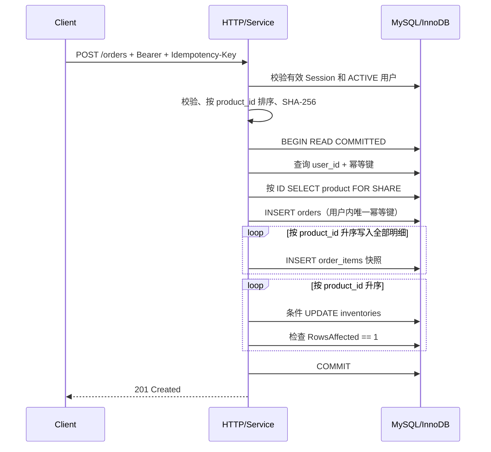
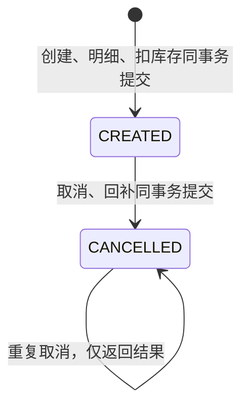
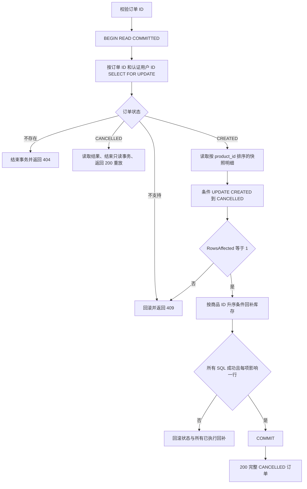

# 订单生命周期、事务与一致性边界

## 正常流程

订单头、所有明细和所有库存变化只有整体提交与整体回滚两种结果。事务中不调用外部 HTTP、支付或消息服务。商品行共享锁确保价格、名称、SKU 和启停状态在本事务内不变；库存条件更新是库存不为负的直接保证，数据库 `UNSIGNED/CHECK` 是最后防线。

## 幂等与并发

- 摘要只包含版本、排序后的商品 ID 和数量；服务端价格、订单号、状态与时间不进入摘要。
- `(user_id,idempotency_key)` 唯一索引是并发裁决者。同用户同键并发插入的失败事务先结束，再用独立查询在该用户作用域读取唯一键赢家。
- 摘要相同返回原订单且不再次扣库存；摘要不同返回 409。
- 不同键竞争库存时，每次条件更新必须影响一行；影响零行会回滚订单和此前扣减。

## 异常与重试

- MySQL 服务端错误按 `go-sql-driver/mysql.MySQLError.Number` 分类；连接中断用 `errors.Is/As` 识别公开哨兵和网络错误类型，不分析错误字符串。
- 1213（死锁）和 1205（锁等待超时）做指数退避的完整事务重试，最多三次尝试；上下文结束立即停止。
- 1053、2006、2013 等关闭/连接错误及 typed transport 错误映射为 503。连接失败不会开启完整事务自动重试；客户端创建重试仍使用原用户和原幂等键。
- 回滚失败与原操作错误一起保留，避免私有 driver 写入错误掩盖公开的连接中断证据；正常 Commit 后的 `sql.ErrTxDone` 不作为新错误。创建和取消使用相同规则。
- `Commit` 返回错误时结果可能不确定。实现不会直接重做事务，而是结束原事务后使用幂等键查询：查到且摘要一致则返回原订单；查不到则返回 503，要求客户端使用同一个键重试。
- 订单号碰撞不会被误判为幂等成功：1062 后必须实际按幂等键查到订单才能返回重放结果。

## 测试边界

集成测试在独立 `order_api_it_*` 数据库中验证真实 MySQL 约束、单/多商品创建、价格快照、回滚、并发幂等和并发抢库存。订单明细故障使用测试库触发器进行可控注入。死锁与锁等待的重试次数通过确定性的 MySQL 错误码单元测试验证；项目不把不可稳定复现的真实死锁宣称为已测试通过。

阶段 10 还在专用故障实例验证暂停、重启、真实客户端超时及进程恢复，并在真实 MySQL Connector 上注入 Commit 回执错误。真实网络故障与受控回执注入的证据、失败轮次和范围见 [故障恢复报告](failure-recovery-report.md)。

## 状态与详情读取

`CREATED` 不代表已支付；`CANCELLED` 不代表已退款。订单金额及明细保留为不可变历史快照。详情通过单条有序 JOIN 读取，同一语句快照避免多条 SELECT 之间混入不同版本；读取不到完整明细或总金额不匹配时安全失败，不返回矛盾结果。

## 取消事务

订单行排他锁串行化同一订单的取消；状态条件更新是回补资格门槛。只有 `CREATED -> CANCELLED` 成功的事务才执行库存更新。重复取消不会进入回补分支。多个订单的库存更新均按商品 ID 升序，复用创建流程的锁顺序。

每次回补使用 `available_qty <= 4294967295 - quantity` 的条件和 `RowsAffected == 1`，避免 `INT UNSIGNED` 溢出；任何失败都回滚整个事务。四张业务表和 `updated_at` 足以支持取消；阶段 6 另通过迁移 5/6 增加身份与所有权，不修改 1～4 号迁移。

取消复用原有错误码分类、指数退避和最多三次尝试。所有重试重新锁定订单、重新检查状态。Commit 返回错误后不立即重做回补，而是以独立有界查询核验当前状态：只有读到完整 `CANCELLED` 结果才返回 200；仍是 `CREATED` 或无法读取时返回 503，客户端对同一订单 ID 重试。请求 context 取消时停止 SQL 和重试；提交后的结果即使客户端未收到，下次取消也不会重复回补。

新增测试在隔离库验证 20 并发取消、多订单共享库存、状态更新 Trigger 失败、后续商品回补 Trigger 失败、溢出、行锁等待 context 超时和查询 SQL 故障。Commit 丢失响应使用受控 database/sql 驱动验证，属于故障注入单元测试，不宣称为真实网络中断复现。

## 安全与部署边界

服务强制回环地址监听且不提供非本地启动开关。阶段 6 增加了 Session 认证和数据库用户归属过滤，但没有公网 TLS、MFA、密码恢复、支付或退款能力，仍仅适用于本地模拟。禁止通过代理、隧道或端口转发公开这些接口。

订单创建身份只取服务端 request context。详情 SQL、取消锁定查询、状态条件更新和提交结果核验都过滤相同 `user_id`。其他用户订单与历史无归属订单统一 404，未认证统一 401；请求体或自定义 Header 无法指定所有者。

认证在进入业务前检查当前 Session 和用户状态。退出及用户停用阻止后续请求，不追溯撤销已经通过中间件的在途事务；如需强制阻断在途操作，需要后续专门设计更强的事务/会话协调。

